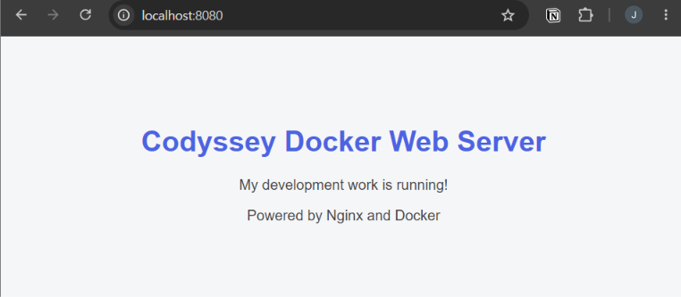
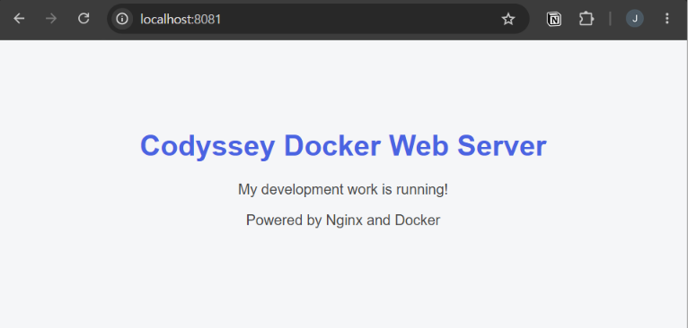
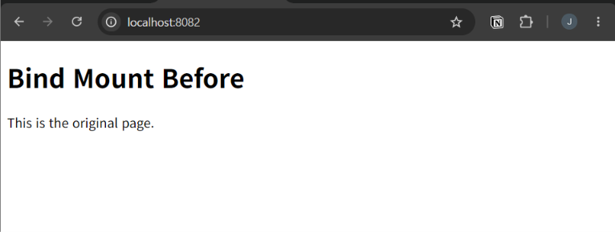
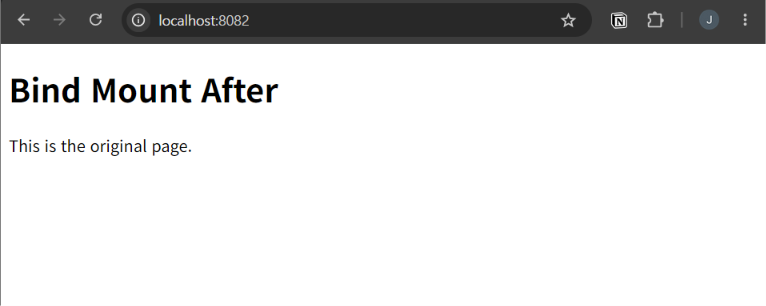

# Codyssey Development Workstation

> Linux CLI · WSL 2 · Docker · Nginx · Git/GitHub를 이용한 재현 가능한 개발 환경 구축 실습

## 프로젝트 소개

Windows 호스트에서 WSL 2 기반 Linux 터미널을 사용하고, Docker 이미지와 컨테이너로 정적 웹 서버를 실행하는 실습 프로젝트입니다. 파일 권한, Dockerfile, 포트 매핑, 바인드 마운트, Docker 볼륨의 차이를 확인하고 Git/GitHub에 소스와 검증 로그를 기록합니다.

**학습 목표**
- 절대 경로와 상대 경로를 구분하고 Linux CLI로 파일·디렉터리를 관리하기
- Linux 권한 `r/w/x` 및 `755`, `644`, `640` 표기 이해하기
- Dockerfile을 기반으로 커스텀 이미지를 빌드하고 컨테이너 실행하기
- 호스트 포트와 컨테이너 포트를 연결하여 웹페이지 확인하기
- 바인드 마운트의 실시간 반영과 이름 있는 볼륨의 데이터 영속성 검증하기
- Git(로컬 버전 관리)과 GitHub(원격 저장소·협업)의 역할 이해하기

## 실행 환경

| 구성 요소 | 확인된 환경 |
| --- | --- |
| 호스트 | Windows + WSL 2 |
| Linux | WSL 2 Linux 커널 `6.18.54.1-microsoft-standard-WSL2` |
| 셸 | Bash 명령을 사용하는 Linux 터미널 |
| Docker | `29.9.2` |
| 웹 서버 | `nginx:alpine` 기반 커스텀 이미지 |
| 이미지 태그 | `codyssey-web:1.0` |
| Git 브랜치 | `main` |
| 원격 저장소 | [qwd-zero/work](https://github.com/qwd-zero/work) |

Windows 및 Ubuntu 배포판의 정확한 버전, Git 버전은 저장된 로그에서 확인되지 않아 기재하지 않았습니다. 확인할 때는 Windows PowerShell에서 `wsl -l -v`, WSL 터미널에서 `cat /etc/os-release`, `git --version`을 실행합니다.

## 저장소 구조

```text
work/
├── .gitignore              # 비밀정보·운영체제 부산물 제외
├── Dockerfile              # Nginx 기반 이미지 정의
├── README.md               # 실행 및 실습 기록
├── permission-test.txt     # Linux 파일 권한 실습
├── site/
│   └── index.html          # 이미지에 복사할 정적 웹페이지
├── live/
│   └── index.html          # 바인드 마운트로 제공할 웹페이지
├── evidence/               # 브라우저 접속·바인드 마운트 스크린샷
│   ├── port-8080.png
│   ├── port-8081.png
│   ├── bind-before.png
│   └── bind-after.png
└── logs/                   # 명령 결과·검증 증거
    ├── docker-*.txt
    ├── port-8080.txt
    ├── port-8081.txt
    ├── bind-*.txt
    ├── volume-*.txt
    ├── permission.txt
    ├── terminal-basics.txt
    ├── file-operations.txt
    ├── troubleshooting-*.txt
    └── git-remote.txt
```

> `backups/`는 실제 볼륨 백업 압축 파일을 보관하는 **로컬 디렉터리**이며 `.gitignore`에 의해 GitHub에 업로드되지 않습니다. `evidence/`의 스크린샷 4개는 GitHub에 등록되어 있습니다. `logs/`에는 백업·파일 관리 실습을 포함한 명령 결과를 보관합니다.

## 빠른 시작

**사전 준비:** Docker 엔진 또는 Docker Desktop(WSL 연동)이 정상 실행 중이어야 합니다. Linux/WSL 터미널에서 다음을 실행합니다.

```bash
git clone https://github.com/qwd-zero/work.git
cd work

docker --version
docker info

docker build -t codyssey-web:1.0 .

docker run -d --name codyssey-web-8080 -p 127.0.0.1:8080:80 codyssey-web:1.0

docker ps
curl http://localhost:8080
```

브라우저에서 **http://localhost:8080** 을 열면 `site/index.html`의 **Codyssey Docker Web Server** 페이지가 나타납니다. 이미 `codyssey-web-8080`이라는 컨테이너가 있으면 새로 실행하기 전에 `docker ps -a`로 확인한 후 기존 컨테이너를 재사용하거나 삭제해야 합니다.

정리:

```bash
docker stop codyssey-web-8080
docker rm codyssey-web-8080
```

위 명령은 해당 예시 컨테이너만 중지·삭제하며 이미지와 볼륨은 삭제하지 않습니다.

## 1. Linux CLI와 경로·권한

작업 위치 및 파일을 확인합니다.

```bash
pwd
whoami
ls -la
mkdir -p practice
ls -ld practice
```

**절대 경로**는 `/`에서 시작합니다. 예: `/home/qwd-zero/codyssey/work/site/index.html`. **상대 경로**는 현재 위치를 기준으로 합니다. 프로젝트 루트에서 `site/index.html`, `./live/index.html` 또는 `../` 등을 사용할 수 있습니다. `pwd`를 통해 기준 위치를 확인하세요.

Linux 권한은 사용자(owner), 그룹(group), 기타 사용자(others) 순으로 표시됩니다.

| 권한 | 숫자값 | 파일에서 의미 | 디렉터리에서 의미 |
| --- | --- | --- | --- |
| `r` | 4 | 읽기 | 항목 이름 조회 |
| `w` | 2 | 수정 | 항목 생성·삭제·이름 변경(관련 권한 필요) |
| `x` | 1 | 실행 | 디렉터리 진입·경로 탐색 |

- `755 = rwxr-xr-x`: 소유자 읽기·쓰기·실행, 나머지 읽기·실행
- `644 = rw-r--r--`: 소유자 읽기·쓰기, 나머지 읽기
- `640 = rw-r-----`: 소유자 읽기·쓰기, 그룹 읽기, 기타 권한 없음

이 저장소에서는 아래 명령으로 `permission-test.txt`가 `644`에서 `640`으로 바뀐 기록이 있습니다.

```bash
chmod 640 permission-test.txt
ls -l permission-test.txt
stat -c '%a %n' permission-test.txt
```

### 파일·디렉터리 생성·이동·삭제 증거 (평가 #1)

실제 터미널에서 테스트 디렉터리를 만들고, 파일을 생성한 후 이름을 변경하고, 파일과 빈 디렉터리를 삭제했습니다. `ls`로 중간 상태를 확인하고 `test ! -e`로 삭제를 검증했습니다.

```bash
# 다른 기존 파일과 충돌하지 않도록 고유한 테스트 디렉터리 사용
DEMO_DIR="file-ops-demo-$(date +%s)-$"
mkdir "$DEMO_DIR"
touch "$DEMO_DIR/before.txt"
ls -l "$DEMO_DIR"
mv "$DEMO_DIR/before.txt" "$DEMO_DIR/after.txt"
ls -l "$DEMO_DIR"
rm "$DEMO_DIR/after.txt"
rmdir "$DEMO_DIR"
test ! -e "$DEMO_DIR" && echo "삭제 검증 성공"
```

실행 증거: [파일 관리 전체 명령·출력](logs/file-operations.txt) — `mkdir`, `touch`, `mv`, `rm`, `rmdir`와 삭제 확인이 포함되어 있습니다.

검증: [기본 터미널 로그](logs/terminal-basics.txt) · [권한 변경 전후 기록](logs/permission.txt) (`644 → 640`, `ls -l` 및 `stat` 확인)

## 2. Docker 기본 검증

```bash
docker --version
docker info
docker run --rm hello-world
docker images
docker ps -a
docker stats --no-stream
```

- **이미지**는 실행 환경의 템플릿이고, **컨테이너**는 이미지의 실행 인스턴스입니다.
- `docker ps`는 실행 중인 컨테이너, `docker ps -a`는 종료된 컨테이너까지 보여줍니다.
- `--rm`은 컨테이너 종료 후 해당 컨테이너를 자동 삭제합니다.
- `docker logs <컨테이너명>`은 표준 출력·오류 로그를 확인합니다.

검증 자료: [버전](logs/docker-version.txt) · [엔진 정보](logs/docker-info.txt) · [hello-world](logs/hello-world.txt) · [이미지 목록](logs/docker-images.txt) · [컨테이너 상태](logs/docker-ps.txt) · [리소스](logs/docker-stats.txt)

## 3. 커스텀 Docker 이미지 빌드

이 저장소의 [Dockerfile](Dockerfile)은 다음과 같습니다.

```dockerfile
FROM nginx:alpine

LABEL org.opencontainers.image.title="codyssey-work"

ENV APP_ENV=development

COPY site/ /usr/share/nginx/html/

EXPOSE 80
```

- `FROM`: Nginx Alpine 기반 이미지 선택
- `LABEL`: 이미지 메타데이터 설정
- `ENV`: 컨테이너 환경 변수 설정
- `COPY`: `site/` 파일을 웹 서버의 문서 루트로 복사
- `EXPOSE 80`: 컨테이너가 사용할 포트 안내(호스트 포트 공개는 하지 않음)

프로젝트 루트에서 빌드합니다.

```bash
docker build -t codyssey-web:1.0 .
docker images
```

마지막 `.`는 현재 디렉터리를 **빌드 컨텍스트**로 지정합니다. `Dockerfile`이 비어 있으면 빌드할 수 없습니다. 확인: [빌드 로그](logs/docker-build.txt) · [웹페이지 원본](site/index.html)

## 4. 포트 매핑: 8080과 8081

각 컨테이너 내부의 Nginx는 **80번 포트**에서 동작합니다. 호스트의 서로 다른 포트를 매핑하면 같은 이미지로 웹 서버를 각각 실행할 수 있습니다.

```bash
docker run -d --name codyssey-web-8080 -p 127.0.0.1:8080:80 codyssey-web:1.0
docker run -d --name codyssey-web-8081 -p 127.0.0.1:8081:80 codyssey-web:1.0

docker ps
curl http://localhost:8080
curl http://localhost:8081
```

### 네트워크 네임스페이스와 포트 매핑 (평가 #13)

일반적인 Docker 브리지 네트워크의 컨테이너는 Linux **네트워크 네임스페이스(network namespace)**를 이용해 호스트와 분리된 네트워크 인터페이스, IP 주소, 라우팅 테이블, 포트 공간을 갖습니다. 따라서 컨테이너에서 Nginx가 `80`번 포트를 사용하더라도 호스트의 `80`번 포트가 자동으로 공개되지는 않습니다.

`-p 127.0.0.1:8080:80`은 **호스트 루프백 주소의 8080 포트 → 컨테이너의 80 포트**로 요청을 전달하도록 포트를 게시합니다. 같은 이미지로 실행한 다른 컨테이너도 독립적인 내부 `80`번 포트를 사용하면서 호스트의 `8081` 등 다른 포트에 연결할 수 있습니다. 바인딩 주소를 생략한 `-p 8080:80`은 Docker 환경에 따라 외부 인터페이스에도 공개될 수 있습니다.

> 예외: `--network host` 모드는 일반적인 브리지 네트워크와 달리 호스트 네트워크를 공유하므로 위와 같은 네트워크 분리·포트 게시 설명을 그대로 적용할 수 없습니다.

| 주소 | 호스트 포트 | 컨테이너 포트 | 저장된 검증 |
| --- | --- | --- | --- |
| http://localhost:8080 | 8080 | 80 | [HTTP 응답](logs/port-8080.txt) |
| http://localhost:8081 | 8081 | 80 | [HTTP 응답](logs/port-8081.txt) |

기록에는 두 컨테이너가 모두 `Up` 상태이고, 두 포트에서 HTML이 응답한 결과가 저장되어 있습니다. 이는 **실습 당시**의 기록이며 현재 실행 상태를 보장하지 않습니다.

추가 자료: [8080 실행](logs/run-8080.txt) · [8081 실행](logs/run-8081.txt) · [docker ps](logs/docker-ps.txt)

### 브라우저 접속 증빙

**8080 포트**



**8081 포트**



## 5. 바인드 마운트: 수정 내용 즉시 반영

**바인드 마운트**는 호스트의 특정 파일·디렉터리를 컨테이너 내부 경로에 연결합니다. 이 프로젝트에서는 `live/index.html`을 Nginx 문서 루트에서 제공하여 이미지 재빌드 없이 변경 내용을 확인합니다.

```bash
docker run -d \
  --name codyssey-bind \
  -p 127.0.0.1:8082:80 \
  --mount type=bind,source="$(pwd)/live",target=/usr/share/nginx/html,readonly \
  codyssey-web:1.0

curl http://localhost:8082
```

위 명령은 반드시 `live/`가 있는 **프로젝트 루트**에서 실행합니다. `readonly`는 컨테이너 내부에서 마운트된 파일을 수정하지 못하게 하며, 호스트에서의 변경은 읽을 수 있습니다. `live/index.html`의 텍스트를 수정한 뒤 다시 `curl`을 실행하면 재빌드 없이 변경된 HTML을 확인할 수 있습니다.

검증: [변경 전 응답](logs/bind-before.txt) · [변경 후 응답](logs/bind-after.txt) · [현재 마운트 대상 파일](live/index.html) · [실행 기록](logs/bind-run.txt)

실습 로그에는 `Bind Mount Before`에서 `Bind Mount After`로 변경된 결과가 남아 있습니다.

```bash
docker stop codyssey-bind
docker rm codyssey-bind
```

### 바인드 마운트 변경 증빙

**변경 전**



**변경 후**



## 6. Docker 이름 있는 볼륨: 컨테이너 삭제 후 데이터 유지

**볼륨**은 Docker가 관리하는 저장 공간입니다. 컨테이너를 삭제하더라도 볼륨을 별도로 삭제하지 않는 한 데이터를 보존할 수 있습니다.

```bash
docker volume create codyssey-data

docker run --name codyssey-vol-1 \
  -v codyssey-data:/data \
  alpine sh -c 'echo "Codyssey Persistent Data" > /data/message.txt'

docker rm codyssey-vol-1

docker run --rm \
  -v codyssey-data:/data \
  alpine cat /data/message.txt
```

예상되는 마지막 출력은 `Codyssey Persistent Data`입니다. 실행 과정에서 동일한 이름의 기존 컨테이너가 남아 있으면 먼저 상태를 확인하세요. 볼륨 자체를 제거하려면 `docker volume rm codyssey-data`를 사용하며, **이 명령은 보존 데이터까지 삭제**하므로 주의합니다.

저장된 실습 결과는 삭제 전과 재실행 후 데이터가 일치합니다: [볼륨 생성](logs/volume-created.txt) · [삭제 전](logs/volume-before.txt) · [컨테이너 삭제](logs/volume-container-deleted.txt) · [삭제 후](logs/volume-after.txt) · [볼륨 정보](logs/volume-inspect.txt)

### 이름 있는 볼륨 백업과 복구 대안 (평가 #17)

컨테이너 삭제 후 데이터가 남는 **영속성**과, 별도 파일로 데이터를 보관하는 **백업**은 다릅니다. 이번에는 실제 볼륨 `codyssey-data`를 Alpine 컨테이너에 읽기 전용으로 마운트하고, 로컬 `backups/volume-backup.tar.gz`에 `tar.gz` 압축 파일을 만든 기록이 있습니다.

프로젝트 루트에서 실행한 백업 절차:

```bash
mkdir -p backups logs
docker volume inspect codyssey-data

docker run --rm \
  --mount type=volume,source=codyssey-data,target=/data,readonly \
  --mount type=bind,source="$(pwd)/backups",target=/backup \
  alpine \
  sh -c 'tar -czvf /backup/volume-backup.tar.gz -C /data .'

ls -lh backups/volume-backup.tar.gz
tar -tzf backups/volume-backup.tar.gz
```

[실제 백업 실행 로그](logs/volume-backup.txt)에는 압축 파일 생성, 파일 목록 조회 및 `hello.txt` 항목이 있습니다. 이 항목은 앞선 영속성 예제의 `message.txt`와 **별개의 백업 시점 자료**이며, 저장된 백업 로그만으로 복구 성공을 확인한 것은 아닙니다. 백업 압축 파일 자체는 `.gitignore`의 `backups/` 규칙에 따라 GitHub에 저장하지 않습니다.

**복원 예시(실행 증거가 아닌 참고 절차):** 기존 볼륨을 덮어쓰지 않도록 새 볼륨을 만들어 압축 파일을 풀고, 내용을 확인할 수 있습니다.

```bash
docker volume create codyssey-restore-test
docker run --rm \
  --mount type=volume,source=codyssey-restore-test,target=/restore \
  --mount type=bind,source="$(pwd)/backups",target=/backup,readonly \
  alpine \
  sh -c 'tar -xzvf /backup/volume-backup.tar.gz -C /restore'

docker run --rm \
  --mount type=volume,source=codyssey-restore-test,target=/data,readonly \
  alpine ls -la /data
```

복원 검증을 마친 뒤 테스트 볼륨이 더 이상 필요하지 않을 때만 `docker volume rm codyssey-restore-test`로 제거합니다. 데이터가 변경되는 서비스라면 정합성 있는 백업을 위해 쓰기를 일시 중단하거나 애플리케이션별 백업 기능을 사용해야 합니다.

### 바인드 마운트와 볼륨 비교

| 구분 | 바인드 마운트 | 이름 있는 볼륨 |
| --- | --- | --- |
| 저장 위치 | 지정한 호스트 경로 | Docker가 관리하는 저장소 |
| 대표 용도 | 소스 코드 실시간 수정 | 데이터베이스·상태 데이터 보존 |
| 이 프로젝트 | `live/` → Nginx 문서 루트 | `codyssey-data` → `/data` |
| 컨테이너 삭제 | 호스트 파일 유지 | 볼륨 유지(별도 삭제 전까지) |

## 7. 오류 해결 기록

### 7-1. 컨테이너 이름 충돌

증상: `Conflict. The container name ... is already in use`

컨테이너 이름은 중지된 컨테이너까지 포함하여 중복할 수 없습니다.

```bash
docker ps -a
docker stop codyssey-bind  # 실행 중인 경우
docker rm codyssey-bind    # 기존 컨테이너를 더 이상 사용하지 않는 경우
```

기존 컨테이너를 보존해야 한다면 새 이름을 사용합니다. 삭제는 해당 컨테이너의 쓰기 계층을 없애므로 필요한 데이터가 없는지 먼저 확인합니다.

### 7-2. 호스트 포트 중복

기록된 실제 오류는 `Bind for 127.0.0.1:8080 failed: port is already allocated`입니다. 동일한 호스트 IP·포트 조합을 두 컨테이너가 동시에 바인딩할 수 없습니다.

```bash
docker ps -a
# 기존 8080 컨테이너가 사용 중이면 다른 호스트 포트를 선택
docker run -d --name codyssey-web-alt -p 127.0.0.1:8083:80 codyssey-web:1.0
curl http://localhost:8083
```

검증: [포트 충돌 오류](logs/troubleshooting-port.txt) · [정상 응답](logs/troubleshooting-port-fixed.txt)

### 7-3. 바인드 마운트 경로 및 표시 문제

마운트 원본 경로를 잘못 입력하거나 잘못된 디렉터리에서 명령을 실행하면 예상한 웹페이지가 나타나지 않을 수 있습니다. 특히 `-v` 구문은 상황에 따라 없는 호스트 디렉터리를 자동으로 만들 수 있어 확인이 필요합니다.

```bash
pwd
ls -ld "$(pwd)/live"
ls -l "$(pwd)/live/index.html"
docker inspect codyssey-bind
curl http://localhost:8082
```

`--mount type=bind`는 존재하지 않는 원본 경로에 대해 기본적으로 오류를 반환합니다. 저장된 [문제 조사 로그](logs/troubleshooting-mount.txt)는 주로 **Nginx 시작 메시지**로, 그 자체만으로 마운트 오류가 발생했다고 단정할 수는 없습니다. [정상 응답 로그](logs/troubleshooting-mount-fixed.txt)에서는 마운트된 HTML을 확인할 수 있습니다.

### 7-4. Dockerfile이 비어 있는 경우

`the Dockerfile cannot be empty`가 표시되면 `cat Dockerfile`로 파일 내용을 확인하고, 이 저장소의 [Dockerfile](Dockerfile)처럼 실제 빌드 지시문을 작성합니다.

### 7-5. hello-world 이미지 이름 오류

`docker run hello`가 아니라 다음을 사용합니다.

```bash
docker run --rm hello-world
```

## 8. Git과 GitHub

- **Git**: 개발자 컴퓨터에서 변경 내용을 추적하고 커밋을 기록하는 분산 버전 관리 도구
- **GitHub**: 원격 저장소 호스팅, 코드 공유 및 Pull Request 등 협업 기능을 제공하는 플랫폼

기본 작업 흐름:

```bash
git status
git add README.md
git commit -m "docs: update workstation README"
git push origin main
git status
```

`Your branch is up to date with 'origin/main'`은 추적 중인 원격 브랜치와 커밋이 일치한다는 뜻입니다. 작업 트리가 깨끗한지는 `nothing to commit, working tree clean` 메시지로 **별도 확인**합니다.

원격 연결: [git-remote.txt](logs/git-remote.txt)

> 이 README를 GitHub 웹 또는 연결된 앱에서 직접 수정했다면, 로컬 복제본에서 작업하기 전에 `git pull --ff-only origin main`으로 최신 커밋을 가져옵니다. 로컬 미커밋 변경이 있으면 우선 `git status`로 확인하세요.

## 9. 제출·검증 체크리스트

- [x] Linux 기본 명령 및 권한 변경 로그 보관
- [x] 파일·디렉터리 생성, 이동, 삭제 실행 로그 보관 (`logs/file-operations.txt`)
- [x] Docker 버전, `hello-world`, 이미지·컨테이너 점검 기록
- [x] Dockerfile 및 Nginx 정적 웹페이지 추가
- [x] 호스트 8080, 8081 포트의 웹 응답 기록
- [x] 네트워크 네임스페이스와 포트 매핑 원리 설명
- [x] 바인드 마운트 수정 전·후 응답 기록
- [x] 볼륨의 컨테이너 삭제 전·후 데이터 동일성 기록
- [x] 이름 있는 볼륨 백업 실행 로그 및 복원 참고 절차 작성
- [x] 포트 충돌 및 마운트 점검 관련 로그 기록
- [x] GitHub 원격 저장소 연결
- [x] 브라우저 및 바인드 마운트 스크린샷 4개를 `evidence/`에 보관하고 링크
- [ ] Windows, Ubuntu, Git 상세 버전 증빙 보완(선택 사항)

**검증 범위:** 체크 표시된 항목은 저장소에 파일·명령 출력 기록이 있거나 이 README에 해당 개념 설명이 있다는 뜻입니다. 현재 로컬 시스템에서 컨테이너가 계속 실행 중이거나, 볼륨 **복원 실습**까지 완료했다는 뜻은 아닙니다.

## 10. 전체 컨테이너 종료 및 정리

프로젝트에서 사용하는 컨테이너만 확인합니다.

```bash
docker ps -a
docker stop codyssey-web-8080 codyssey-web-8081 codyssey-bind 2>/dev/null || true
docker rm codyssey-web-8080 codyssey-web-8081 codyssey-bind 2>/dev/null || true
docker ps -a
```

존재하지 않는 이름은 오류가 발생할 수 있으며 위 예시는 이를 무시합니다. `codyssey-vol-1`은 실습에서 이미 삭제하는 예시입니다. 이미지와 볼륨은 위 명령으로 삭제되지 않습니다. 재빌드가 필요 없다면 이미지는 남겨 두어도 됩니다.

이미지를 지우려면 해당 이미지를 쓰는 컨테이너가 없는지 확인한 다음 `docker image rm codyssey-web:1.0`을 사용합니다. 볼륨 `codyssey-data`는 보존할 데이터가 없는 경우에만 별도로 삭제합니다.

---

이 저장소는 Codyssey 개발 워크스테이션 구축 실습의 소스 코드와 실행 검증 로그를 정리한 학습 기록입니다.
